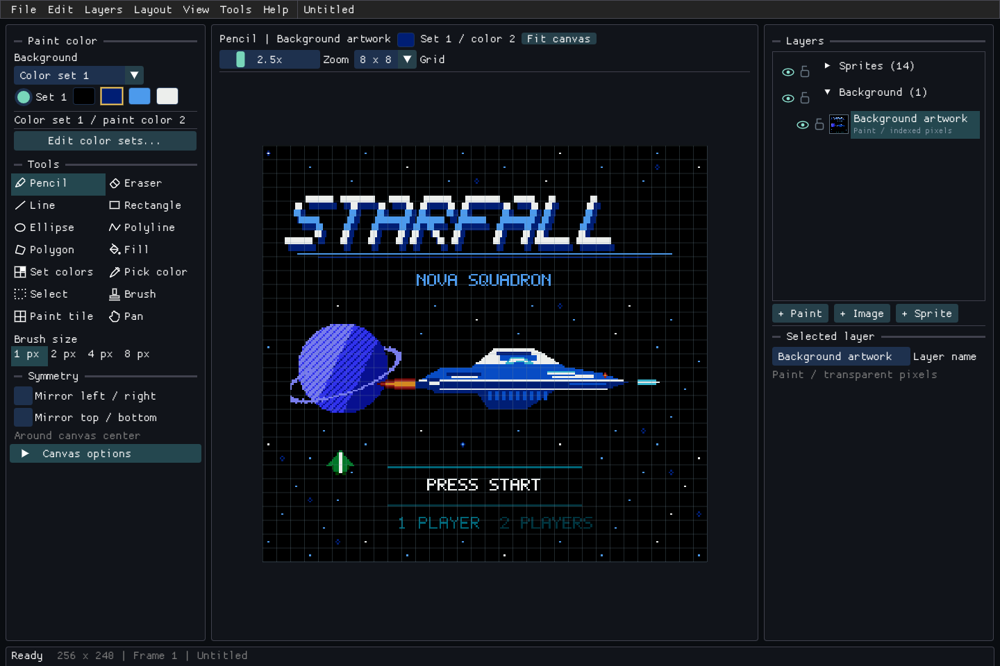
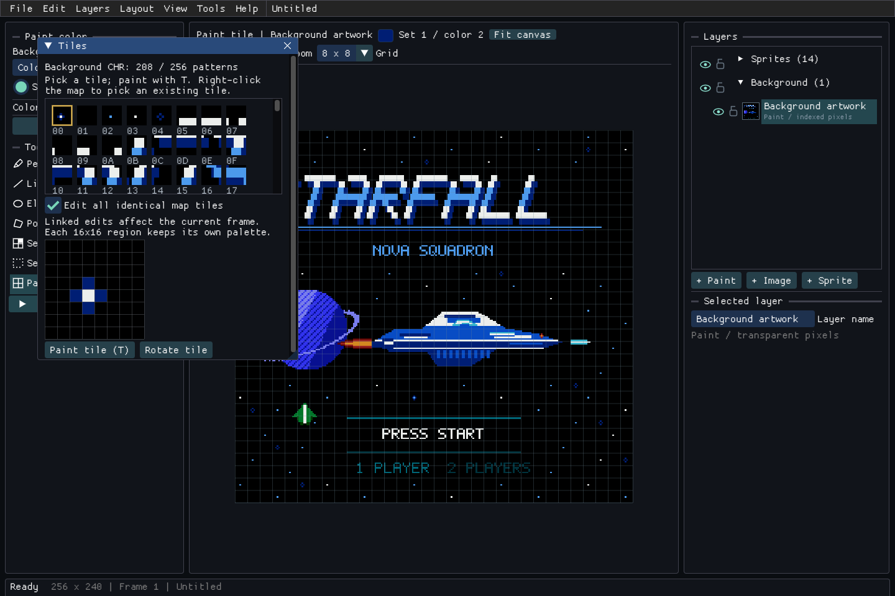
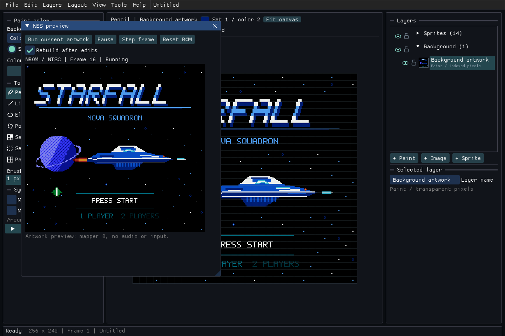

# tilezeitjobb

[](https://github.com/varnholt/tilezeitjobb/actions/workflows/build.yml)

A pixel and tile editor for the NES, written in C++23. Draw with hardware color sets, edit repeated tiles in place,
arrange sprites and compile the picture directly into a runnable NES ROM. The editor and command-line tools share
the same image model and exporter.

**[Open the web editor](https://varnholt.github.io/tilezeitjobb/)** - Runs in your browser; no installation needed.

| | |
|---|---|
|  |  |
| tools and paint colors beside the canvas | edit a tile once and update its matching map instances |

The screenshots show STARFALL, the original space-shooter example included with the editor. Its 208 background patterns and 14 sprite objects compile directly into a valid NES ROM; cockpit glow, engine flame, laser and wingman remain separate editable sprites.

- indexed drawing: pencil, fill, eraser, lines, connected lines, outlined/filled polygons, rectangles and ellipses, color picking,
  selections and captured brushes
- live shape previews, constrained lines/squares/circles, and mirrored drawing on the canvas or selected sprite
- linked 8x8 tiles: paint maps, inspect pattern usage and edit matching tiles together
- four background and four sprite color sets, palette copying and appearance-preserving slot swaps
- sprite objects with per-object colors, position, visibility, flipping and background priority
- frame editing, timed playback and onion skin; brush rotation, flipping, transparency and edge wrapping
- image import, ordered dithering, automatic palette fitting and source-image watching that preserves background paint
- direct NROM ROM export, plus CHR, nametables, palettes, OAM and C arrays for use in a game

## First picture

Choose **Draw a background**, **Create a sprite**, or **Import a picture** on the starting screen.
Pick a layer on the right, a paint color and tool on the left, and draw in the center.
Hover controls for explanations. **Save** keeps an editable project; **Export NES** produces
a ROM for an emulator. Use **Help > Start here** to reopen the starting choices.

A new sprite starts blank with three paint colors and transparency. No sprite sheet is required.

## Use

[Build the editor](#build), then open a project, import a picture or start with the demo:

```sh
tilezeitjobb --demo --fullscreen
```

The editor starts maximized. F11 switches between fullscreen and the previous window state.

Use **File** to create, open, save, import or export artwork. Select a background layer or sprite
in the layer stack to edit it; the paint colors, tools and properties follow your selection.
**View → Tile editor**, **Animation timeline** and **NES limits** open optional panels without changing
your editing target. **View → Fullscreen** (F11) switches the desktop window to fullscreen.

Click a color swatch to choose paint; right-click it to edit the NES color. The active tool and paint color are also
shown above the canvas. View > Advanced layout exposes the dockable workspace, including attribute inspection,
hardware reports, the original palette-test animation and separate preview panels.

| Input | Action |
|---|---|
| left drag | draw or use the active tool |
| right drag with Pencil or a shape tool | paint the background color / erase sprite pixels |
| L / B / O | line / rectangle / ellipse |
| K / G | connected lines / polygon |
| Enter / right-click with a path tool | finish the path as one undo step |
| Backspace / Esc with a path tool | remove last point / cancel the path |
| Shift while dragging a shape | horizontal, vertical or 45-degree line; square or circle |
| Esc while dragging a shape | cancel its preview |
| middle drag / wheel | pan / zoom |
| P / E / F / I | pencil / erase / fill / pick color |
| R / Ctrl+C / V | select / capture the selection / paint with the captured brush |
| T / right-click with T | paint a tile / pick a map tile |
| S / M | place / move a sprite |
| 1..4 / [ / ] | paint color / decrease or increase brush size |
| Ctrl+Z / Ctrl+Y | undo / redo |
| Ctrl+S / Ctrl+O / Ctrl+E | save / open / export NES |
| F11 | toggle fullscreen |

### Tiles, colors and brushes

A background region is 16x16 pixels and shares one of four color sets. Drawing and filling assign the chosen color
set to touched regions, so the painted pixel matches the selected swatch. Other pixels in that same region share its
colors, as on the NES.

The tile catalog lists unique 8x8 background patterns in export order, with their map usage counts. Pick a tile and
paint with T. Editing its large pixel grid updates every identical pattern in the current frame; disable linked
editing to change only the picked map location. Each region keeps its color set. Identical patterns merge, and
unused patterns disappear: the catalog is derived from the map, rather than a library of unplaced assets.

Captured brushes rotate in exact 90-degree steps and flip horizontally or vertically. Slot-zero transparency, 8x8
snapping and wrapping across canvas edges are independent options. Brushes store color-slot indices, so the
receiving region supplies their colors. Captured brushes are temporary; save their artwork in the project.

Palette operations can swap nonzero slots while remapping background pixels, sprite patterns and paint overrides
across all frames, preserving the rendered artwork. Slot zero remains the universal backdrop or sprite transparency.
Remapping one color set may split previously shared patterns; the catalog and export limits update accordingly.

Color-set management lives in **Edit color sets...**, beside the paint swatches. It opens a dedicated
editor for hardware colors, set copying and indexed slot swaps. Hover controls and technical readouts
for explanations, including disabled options.

## Layers

The layer stack shows sprites above the background group. Background layers are listed from top to bottom,
with thumbnails, visibility and lock controls. Drag rows to reorder them within their group. Use the
**Layers** menu or a row's context menu to duplicate, merge or delete layers.

Imported images retain their original pixels. Select an image layer to adjust its crop, size, position,
brightness, contrast and dithering. Conversion supports Bayer 2x2, 4x4 and 8x8, Floyd–Steinberg, Atkinson,
or no dithering. **Make paintable copy** captures the converted result as an independent paint layer;
the source layer remains available for other variants. Erasing paint reveals the layers underneath.

Background layers share the scene's NES color sets and 16x16 attribute regions. Only visible artwork
contributes to scene export. Layers and modifiers are saved in the project and participate in undo/redo.

## MCP connection

In the desktop editor, open **Tools → MCP server...**, select **Start server**, then
**Copy connection configuration**. Add that stdio server definition to your MCP client's configuration.
Keep the editor open while connected.

The connection controls the project visible in the editor. Available tools inspect layers and sprites,
return PNG previews, create/import and duplicate layers, adjust image dithering, paint pixel batches,
add sprites, undo/redo, validate NES limits and export ROMs and assets. Successful artwork changes appear
immediately and form one undo step each; rejected edits leave the project and undo history unchanged.
Background-layer indices are zero based, bottom to top, as reported by `get_project`.

The server is off at startup. It accepts one client at a time through an authenticated local connection;
the client launches the same executable with `--mcp-connect PORT TOKEN` as its stdio relay. **Stop server**
disconnects the client. Restarting generates a new token, so copy the configuration again. Desktop MCP
is not available in the GitHub Pages editor. Advanced users can start the desktop server with `--mcp`.

## NES export

Export NES writes the current frame as a mapper-0 NROM-128 cartridge image. It includes a 6502 startup routine,
PPU initialization, pattern and palette data, sprite DMA and per-frame NMI OAM refresh. No assembler or external
NES toolchain is needed.

```sh
tilezeitjobb-cli compile scene.tzj output/scene --frame 0
```

The output directory must already exist. The exporter writes:

| File | Contents |
|---|---|
| `.nes` | iNES mapper-0 ROM: 16 KiB PRG and 8 KiB CHR |
| `.chr` | 4 KiB background patterns followed by 4 KiB sprite patterns |
| `.nam` | one or two 1,024-byte nametables, each with its 64-byte attribute table |
| `.pal` | 16 background and 16 sprite palette bytes |
| `.oam` | 256 bytes of object attributes; unused sprites hidden |
| `.h` | the same assets as static C arrays |

The ROM displays the first 256x240 viewport of the selected frame. A second nametable is uploaded with the correct
mirroring for a 512x240 or 256x480 picture. Timeline playback and interactive scrolling are editor features, not
part of the exported ROM runtime; animated ROM playback is not implemented yet.

Open `.nes` files in an emulator or on a flash cartridge supporting mapper 0. Programming a physical cartridge also
requires a matching board and programmer. Emulator boot and rendering are tested; physical hardware has not been tested.

### Hardware limits

| | |
|---|---|
| Background layouts | 256x240, 512x240 or 256x480 |
| Patterns | at most 256 unique background tiles and 256 unique sprite tiles |
| Colors | four background and four sprite subpalettes; four entries each, with shared backdrop/transparency |
| Sprites | 8x8; at most 64 visible objects and eight per scanline |
| Sprite positions in the ROM | X 0..255, Y 1..239, relative to the initial viewport |

The exporter rejects scenes outside these limits and unsafe color `$0D`. RGB appearance varies between console
revisions, video signals and emulator palette settings. The editor can preview sprite limits and highlight color regions.

## Built-in NES preview

Open **View → NES preview** and select **Run current artwork**. The editor compiles the current frame
into a ROM in memory and boots it in its own small C++ emulator. **Pause**, **Step frame** and **Reset ROM**
control cartridge execution. **Rebuild after edits** refreshes the ROM when painting finishes; invalid
artwork keeps the last working ROM visible. The display uses integer scaling and sharp pixels.

The same core runs on desktop and WebAssembly, with no external emulator dependency. It implements
documented 6502 instructions, NROM mapping, PPU registers and video, vblank/NMI, OAM DMA, sprite priority,
flipping and the eight-sprites-per-scanline limit. It is focused on the exported artwork ROMs: audio,
controller input, unofficial opcodes, banked mappers and cycle-exact PPU fetch behavior are not implemented.
The ordinary editing canvas remains a direct artwork view. Timeline animation is not yet compiled into the ROM.



```sh
tilezeitjobb --demo --nes-preview
```

## Command line

```sh
tilezeitjobb-cli demo output/demo
tilezeitjobb-cli import picture.png scene.tzj --auto-palettes
tilezeitjobb-cli import wide.png scene.tzj --layout horizontal
tilezeitjobb-cli inspect scene.tzj
tilezeitjobb-cli batch images output/chr --crop 0 0 7 9 --palette colors.pal
```

Batch conversion processes PNG and BMP files into sequential 4 KiB CHR banks. Crop coordinates and dimensions are in
8x8 tiles. A batch palette is exactly four NES color-code bytes; the default is `$0F,$01,$21,$30`.
Frame numbers are zero based. Run `tilezeitjobb-cli --help` for the command summary.

## Browser editor

[Open the web editor](https://varnholt.github.io/tilezeitjobb/). The browser version runs the same C++23
editor and NES compiler through WebAssembly and WebGL 2. Use a mouse and keyboard.

Open and Import use your browser's file picker. Save downloads a `.tzj` project. Export NES downloads
a ZIP containing the runnable `.nes` ROM, CHR, nametable, palette, OAM and C header. Projects are also
autosaved locally in the browser every ten seconds and restored on your next visit; downloading a project
keeps a portable copy when browser storage is cleared. Files are processed on your device.

GitHub Actions builds and publishes the web editor on every push to `master`. To build it locally with
Emscripten 4.0.10 or newer:

```sh
emcmake cmake -S . -B build-web -DCMAKE_BUILD_TYPE=Release -DBUILD_TESTING=OFF
cmake --build build-web --parallel 2 --target tilezeitjobb
python -m http.server 8080 --directory build-web
```

Open `http://localhost:8080`. Serve the HTML, JavaScript, WASM and data files together; opening the HTML
directly from the filesystem does not work.

## Build

Requirements: CMake 3.24+, Git, a C++23 compiler and an OpenGL 3.3 driver. The first configuration downloads pinned
Dear ImGui, GLFW, nlohmann/json and stb sources. The command-line tools and tests do not require a graphics context.

Windows, with Visual Studio 2022 and Desktop development with C++:

```powershell
cmake --preset windows
cmake --build --preset windows --parallel 1
ctest --preset windows
.\build\Release\tilezeitjobb.exe --demo
```

Linux, with OpenGL and the X11/Wayland development headers installed:

```sh
cmake -S . -B build -DCMAKE_BUILD_TYPE=Release
cmake --build build
ctest --test-dir build --output-on-failure
./build/tilezeitjobb --demo
```

| Option | Default | |
|---|---|---|
| `TZJ_BUILD_EDITOR` | `ON` | ImGui desktop editor; disable for a headless conversion build |
| `BUILD_TESTING` | `ON` | core and editing-workflow tests |

Install the editor, CLI, palette-test assets and licenses together:

```sh
cmake --install build --config Release --prefix package
```

## Project files

Version 2 `.tzj` files are self-contained JSON: indexed frames, color regions, palettes, sprite objects and source
images are stored together. Saves use a temporary file followed by replacement of the destination. Undo/redo keeps
up to 32 snapshots with a 64 MiB history target.

The original QSettings INI `.tzj` format is also accepted. Its referenced images must still exist; relative paths
resolve beside the project. Legacy RGB colors are mapped to NES color codes, and image dimensions infer a two-screen
layout. Check that layout after import, since the old project format did not store it. Saving writes version 3,
which the original Qt application cannot read. Loading alone does not modify the original file.

## Tests

| Suite | Coverage |
|---|---|
| Core | CHR bitplanes, deduplication, attribute packing and screen boundaries, OAM, ROM headers/vectors, file roundtrips, legacy import and hardware-limit rejection |
| Drawing tools | shape rasterization, clipping, filled/outlined ellipses, symmetry, sprite flips, paint masks and undo |
| Editing workflows | linked tile updates, tile painting, brush rotation and wrapping, palette remapping, selected-color drawing/fill and undo |
| Layer workflows | compositing, transparency, visibility, locking, modifiers, independent paint copies, layer migration and project roundtrips |
| MCP | protocol handshake, tool contracts, atomic edits, undo, locks, PNG previews, server lifecycle and authenticated stdio relay |
| Built-in emulator | documented opcode decoding, arithmetic/stack behavior, PPU registers, mirroring, NMI, scanline limits and cartridge boot; 61,440 pixels and nametable uploads compared for demo, wide/tall and layered sprite scenes |
| Optional external verification | five exported scenes booted for 120 frames in pinned JSNES 2.1.0; rendered pixels and nametable bytes compared with project data |

```sh
ctest --test-dir build -C Release --output-on-failure
```

Normal builds, tests and GitHub Pages do not install or ship JSNES. An independent check is available
through the manually run **Optional external ROM verification** GitHub Actions workflow, or locally:

```sh
npm ci --prefix tests/emulator --ignore-scripts
node tests/rom_emulator.mjs tests/emulator/node_modules/jsnes/src/index.js build/test-output
```

The optional JSNES comparison checks 61,184 pixels per frame; its pre-render dummy framebuffer row is excluded.
The desktop smoke test also renders real editor screenshots, for example on Windows:

```powershell
.\build\Release\tilezeitjobb.exe --demo --workspace tiles --smoke-test --screenshot tiles.png
```

## Layout

| Path | Contents |
|---|---|
| `src/core/` | project model, image conversion, editing operations and NES compiler |
| `src/app/` | desktop workspace and rendering |
| `src/cli.cpp` | headless conversion and export commands |
| `src/mcp/` | optional desktop MCP protocol, editing commands and local connection |
| `src/emu/` | self-contained C++ CPU, PPU and NROM preview core |
| `tests/` | core, editing and emulator integration tests |
| `data/paltesteffect/` | original animated palette-test patterns |
| `docs/images/` | screenshots rendered by the editor |

## Not yet

- pixel-perfect stroke cleanup, curves and gradient drawing
- animated ROM playback, sprite-sheet animation export and richer animation editing
- metasprites, 8x16 sprites and a persistent library of unplaced tiles
- banked mappers and physical hardware verification

## Background

The project began as a Qt-based NES paint tool. The current editor uses Dear ImGui, GLFW and OpenGL, with a separate
C++23 core shared by the GUI, command-line tools and tests. The [original editor screenshot](tilezeitjobb.png) remains
in the repository.

## License

MIT, see [LICENSE](LICENSE). Dear ImGui and GLFW retain their upstream licenses; nlohmann/json is MIT and stb is
public-domain/MIT. JSNES is an optional Apache-2.0 test dependency. Installed packages include the runtime dependency licenses.
